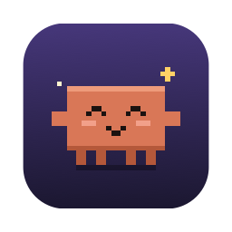
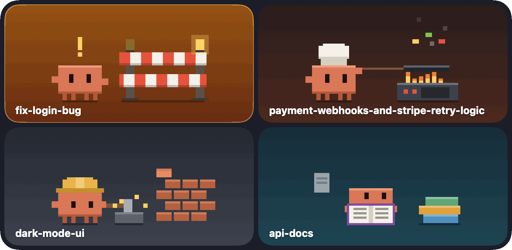
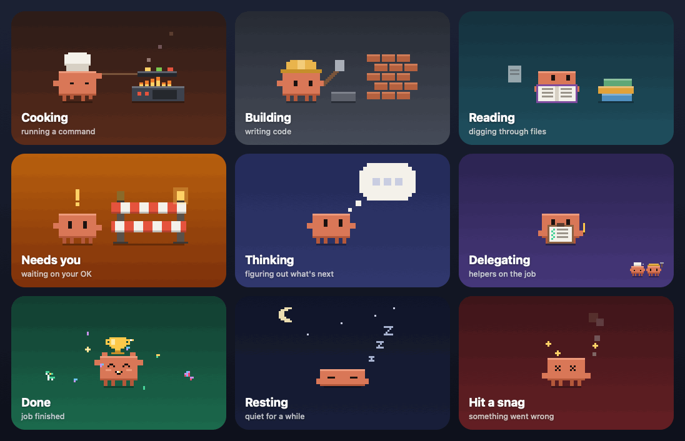
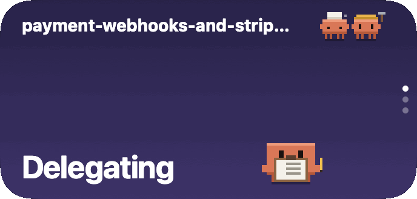

<p align="center"></p>

<h1 align="center">Nook</h1>

<p align="center">
  <b>Your Claude Code sessions, living on your desktop.</b><br>
  A tiny pixel crew that cooks, builds and reads while your agents work,<br>
  and waves you down the moment one needs you.
</p>

<p align="center">
  <a href="https://github.com/sanki92/nook/releases/latest"></a>
  
  
  
</p>

<p align="center"></p>

## Get it

```bash
curl -fsSL https://raw.githubusercontent.com/sanki92/nook/main/install.sh | bash
```

That's it. Nook builds on your Mac and pops onto your desktop.

Rather click? Grab **Nook.zip** from [Releases](https://github.com/sanki92/nook/releases/latest) and drag it into Applications. The first time you open it, go to System Settings → Privacy & Security and hit **Open Anyway**.

## Meet the crew

Every session gets its own little mascot, acting out whatever it's doing right now.

<p align="center"></p>

## Feels like a real widget



- Snaps into the same grid as Apple's widgets, on any screen
- Right-click for **Medium**, **Large** or **Extra Large**
- Swipe the Medium one to flip between sessions
- Helper agents tag along as tiny mascots
- Click a tile to jump straight to its terminal
- Fades with your other widgets while you work in an app

<br clear="right">

It hangs out in your menu bar too, showing whichever session matters most.

## Private by design

Nook only reads the files Claude Code already keeps on your Mac. No account, no API key, and nothing ever leaves your machine.

<p align="center"><br><sub>Nothing running? The crew camps out.</sub></p>

<details>
<summary><b>Build from source</b></summary>

You only need Apple's Command Line Tools.

```bash
git clone https://github.com/sanki92/nook.git
cd nook
./build.sh --install
open ~/Applications/Nook.app
```

</details>

<details>
<summary><b>Uninstall</b></summary>

Right-click Nook and choose **Remove Widget**, then:

```bash
rm -rf ~/Applications/Nook.app /Applications/Nook.app
defaults delete app.nook.widget
```

</details>

<sub>Nook is an unofficial fan project and isn't affiliated with Anthropic. Claude Code is a trademark of Anthropic. MIT licensed.</sub>
